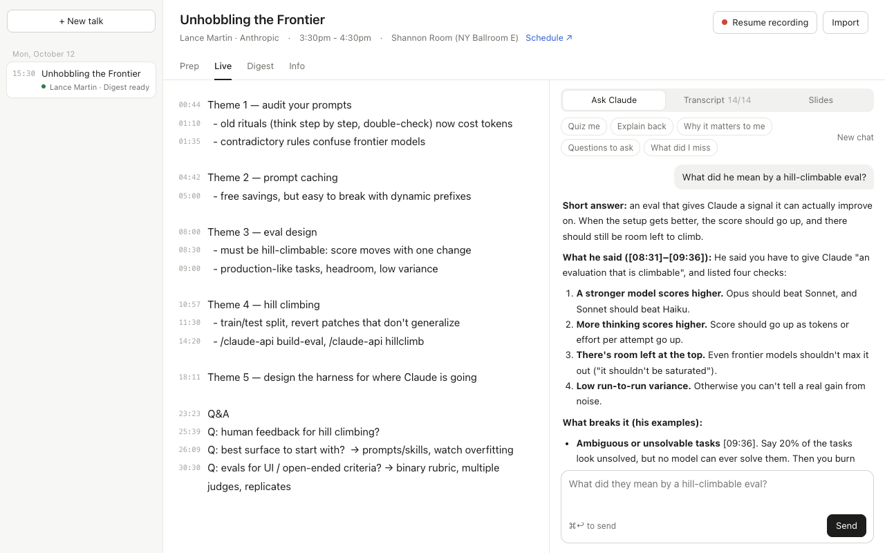
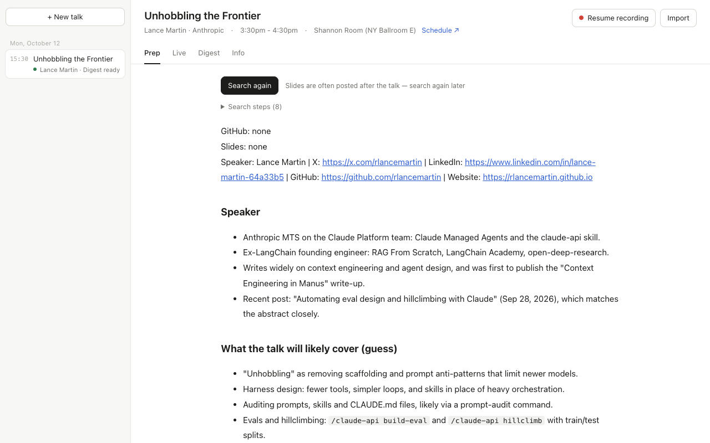
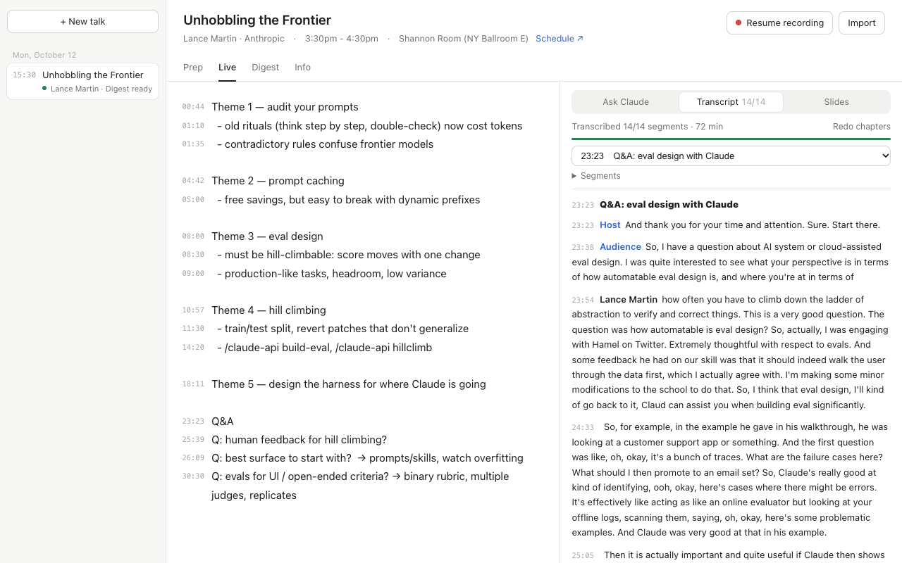
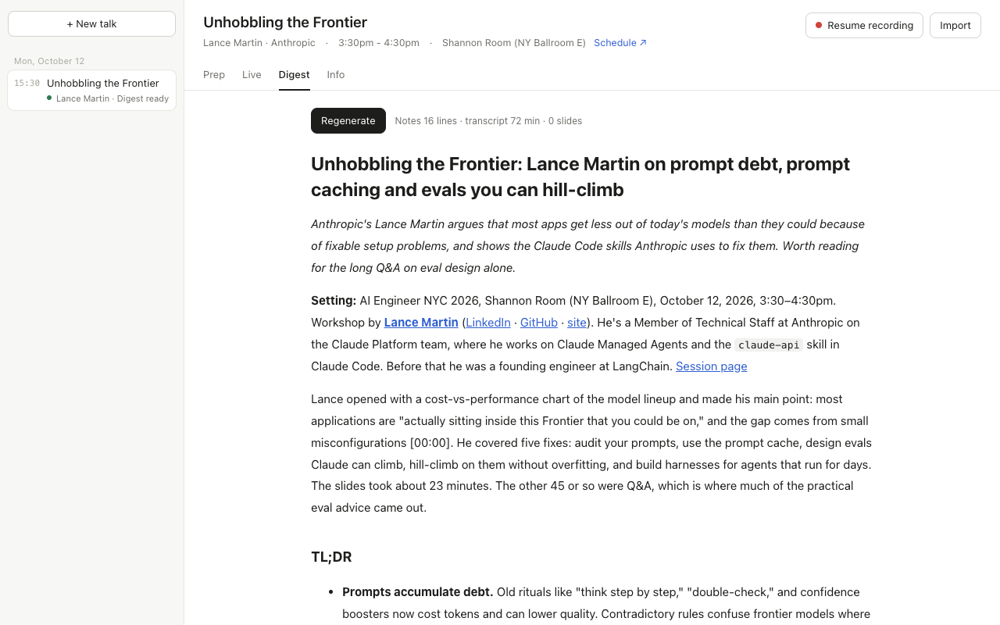

# AI Engineer NYC 2026 Assistant

A local web app for getting more out of conference talks, built during [AI Engineer NYC 2026](https://ai.engineer/nyc/2026). It records and transcribes on your Mac, keeps your notes timestamped against the recording, lets you ask Claude about what was just said, and turns it all into a write-up afterwards.

**Your notes are the backbone; the transcript is support.** Write-ups and reviews follow what you chose to write down, and use the transcript for detail and exact quotes.



## What it does

- **Prep** — paste a session link (or pick several talks from the day's schedule) and Claude searches the web for the talk's GitHub repo and slides, the speakers' accounts and background reading, then writes a 3-minute brief.
- **Record** — ffmpeg records in 10-second pieces (a crash loses at most 10 s). Every 5–6 minutes it cuts at a pause and transcribes locally with Whisper large-v3-turbo, prompted with the talk title, speaker names and an AI-engineering glossary. `⌘K` cuts now.
- **Notes** — a plain editor; each line remembers when you first typed it.
- **Ask Claude mid-talk** — asking cuts the current segment and transcribes it first, so "what did they just mean?" works. One-click modes: *Quiz me*, *Explain back*, *Why it matters to me*, *Questions to ask*, *What did I miss*.
- **Transcript** — split into chapters with speaker turns (speaker vs. audience) once the talk ends; jump around with the chapter picker.
- **Slides** — AirDrop your phone's slide photos and drop them on the page; they're placed by capture time. Flip through them with ← →.
- **Digest** — one click for a full write-up: themes from your notes, the speaker's quotes with timestamps, the slides, every Q&A question, and what you might have missed.
- **Phone recording as backup** — import a Voice Memos file to fill gaps or re-transcribe a whole talk.

| Prep brief | Transcript with chapters and speakers |
|---|---|
|  |  |



## Requirements

- An Apple Silicon Mac (recording uses macOS AVFoundation; Whisper runs on Metal)
- [Homebrew](https://brew.sh), Node.js 22+
- [Claude Code](https://claude.com/claude-code), signed in — chat, prep, chapters and digests run through your own `claude` CLI

## Quick start

```bash
git clone https://github.com/jinxuan/ai-engineer-nyc-2026-assistant
cd ai-engineer-nyc-2026-assistant
scripts/setup.sh      # ffmpeg, whisper.cpp, the Whisper model (~550 MB)
node server.mjs       # → http://localhost:4318
```

No npm install — there are no dependencies. The first recording triggers macOS's microphone permission prompt for your terminal.

To keep it running in the background (starts at login, restarts if it crashes):

```bash
scripts/service.sh install    # also: status | restart | logs | uninstall
```

## A talk, start to finish

1. **New talk** → paste the ai.engineer session link, or switch to *Pick from schedule* and tick everything you plan to see tomorrow. Prep starts automatically (up to 3 at once).
2. **Start recording** when the talk begins — wait ~4 s for the timer to move (the mic takes a moment to open).
3. Take notes on the left; ask Claude on the right.
4. Stop when it ends. Drop in your slide photos. Chapters and speakers appear on their own.
5. **Digest** → *Generate digest*.

## Your data

Everything stays on your Mac, in plain files — one folder per talk under `talks/`:

```
talks/2026-10-14 0900 <title>/
  session.json   schedule info, recording segments, slide times
  notes.md       your notes (notes.json keeps the times)
  transcript.md  transcript with chapters and speakers
  prep.md        prep brief
  digest.md      write-up
  chat.md        your conversation with Claude
  links/         text snapshots of reference links
  audio/         recording pieces (Opus, ~11 MB/hour) and per-segment transcripts
  slides/        photos (resized to 1600 px) and decks
```

Audio is transcribed locally. Notes, transcript text and slide photos are sent to Claude through your Claude Code CLI when you chat, prep or generate a digest.

## Settings

Optional `local/config.json` (gitignored):

```json
{
  "dataRoot": "/Users/you/Documents/conference-notes",
  "audioDevice": "MacBook Air Microphone",
  "prepEngine": "claude"
}
```

`audioDevice` defaults to the system input; list devices with `ffmpeg -f avfoundation -list_devices true -i ""`. Environment variables `PORT`, `TALK_DATA`, `AUDIO_DEVICE`, `WHISPER_MODEL` and `CLAUDE_BIN` override the same settings.

`local/strings.json` and `local/prompts/<name>` override the UI text and the prompts in `strings/` and `prompts/` — handy for another language or your own write-up style.

## Other conferences

The schedule lookup reads ai.engineer's schedule page (`scheduleUrl`, `conference`, `timezone` and the Whisper `glossary` are in `lib/config.mjs`). Without a link you can always create a talk by title; everything else works the same.

## License

MIT
